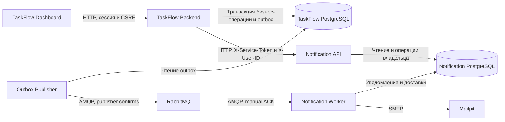
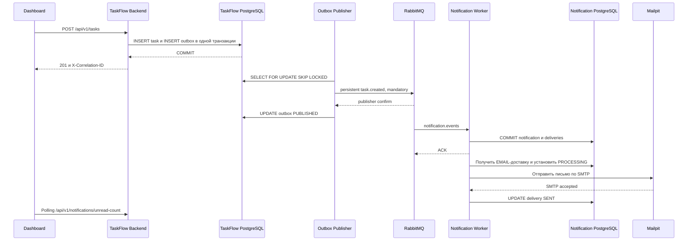

# TaskFlow Notification Service

Сервис принимает события из RabbitMQ, сохраняет уведомления в собственной
PostgreSQL и отправляет письма через SMTP в локальный Mailpit. Notification API
и Worker запускаются из одного образа. Их можно останавливать независимо.

## Архитектура





TaskFlow фиксирует бизнес-операцию и полный envelope в одной транзакции.
Publisher берёт одну строку через `FOR UPDATE SKIP LOCKED`, публикует
persistent message с `mandatory` и ждёт broker confirm. При сбое строка
остаётся `PENDING` с новым временем попытки, backoff от 2 до 30 секунд.
Повторное использование `event_id` при сбое между confirm и коммитом
обеспечивает доставку at least once в сочетании с дедупликацией consumer.

TaskFlow использует сессионную cookie, поэтому HTTP-прокси проверяет
существующую сессию и CSRF для мутаций и передаёт только вычисленный сервером
ID пользователя и общий service credential. Notification Service проверяет
credential и ограничивает запросы по `user_id`. Операции по чужому ID
возвращают 404. У каждого проекта своя сеть и свой PostgreSQL. Только TaskFlow
Backend, Outbox Publisher, Notification API и RabbitMQ подключены к внешней
`taskflow-network`. Внутри Docker используются DNS-имена сервисов.

## Запуск в PowerShell

Команды в блоке ниже запускаются из корня репозитория. Для независимого режима
достаточно первого блока. Перед первым запуском откройте созданный `.env` и
задайте локальные значения паролей и токена. Длина токена от 16 символов.

```powershell
Set-Location notification-service
if (-not (Test-Path .env)) { Copy-Item .env.example .env }
./scripts/ensure_network.ps1
docker compose up -d --build --wait
docker compose ps --all
```

Из директории Notification Service можно остановить весь проект
`docker compose down`. Локальные volumes и внешняя сеть сохраняются.

Для совместного запуска вернитесь в корень репозитория. Создайте корневой
`.env` из корневого примера при необходимости. Установите в нём одинаковые
с Notification Service значения `RABBITMQ_USER`, `RABBITMQ_PASSWORD`,
`RABBITMQ_VHOST`, `RABBITMQ_EXCHANGE`, `RABBITMQ_QUEUE` и
`INTERNAL_SERVICE_TOKEN`. Для изменённого `APP_PORT` укажите соответствующий
контейнерный порт в `NOTIFICATION_API_URL`.

```powershell
Set-Location ..
if (-not (Test-Path .env)) { Copy-Item .env.example .env }
./notification-service/scripts/ensure_network.ps1
docker compose -f compose.yaml -f compose.notifications.yaml up -d --build --wait
```

Базовый `docker compose up -d --build` в корне запускает TaskFlow без интеграции
и внешней сети. В совместном Compose можно задать `NOTIFICATIONS_ENABLED=false`.
При возврате из совместного режима остановите Outbox Publisher командой
`docker compose -f compose.yaml -f compose.notifications.yaml stop outbox-publisher`.

| Интерфейс | По умолчанию |
|---|---|
| Dashboard | http://127.0.0.1:5173/tasks |
| TaskFlow Swagger | http://127.0.0.1:8000/docs |
| Notification Swagger и OpenAPI | http://127.0.0.1:8001/docs · http://127.0.0.1:8001/openapi.json |
| Notification PostgreSQL | `127.0.0.1:5433` |
| RabbitMQ Management | http://127.0.0.1:15672 |
| RabbitMQ AMQP | `127.0.0.1:5672` |
| Mailpit Web и REST | http://127.0.0.1:8025 · http://127.0.0.1:8025/api/v1/ |
| Mailpit SMTP | `127.0.0.1:1025` |

Все публикации портов используют `127.0.0.1`. Если Windows резервирует порт или
он занят, задайте свободный host-порт в `.env`, например
`NOTIFICATION_DB_HOST_PORT=5543` или `MAILPIT_SMTP_HOST_PORT=2525`.
Внутренние порты PostgreSQL и SMTP при этом остаются 5432 и 1025.

## Конфигурация

| Переменные | Назначение |
|---|---|
| `APP_ENV`, `APP_HOST`, `APP_PORT`, `LOG_LEVEL` | Метка окружения, bind API и уровень событийных логов |
| `NOTIFICATION_API_HOST_PORT`, `NOTIFICATION_DB_HOST_PORT` | Публикуемые порты API и PostgreSQL |
| `RABBITMQ_AMQP_HOST_PORT`, `RABBITMQ_MANAGEMENT_HOST_PORT` | Публикуемые порты RabbitMQ |
| `MAILPIT_SMTP_HOST_PORT`, `MAILPIT_WEB_HOST_PORT` | Публикуемые порты Mailpit |
| `POSTGRES_HOST`, `POSTGRES_PORT`, `POSTGRES_DB`, `POSTGRES_USER`, `POSTGRES_PASSWORD` | Собственная БД, DNS-имя `notification-db` |
| `RABBITMQ_HOST`, `RABBITMQ_PORT`, `RABBITMQ_USER`, `RABBITMQ_PASSWORD`, `RABBITMQ_VHOST` | Подключение к брокеру, DNS-имя `rabbitmq` |
| `RABBITMQ_EXCHANGE`, `RABBITMQ_QUEUE` | Общие имена бизнес-exchange и основной очереди |
| `EVENT_MAX_RETRIES`, `EVENT_RETRY_INTERVAL_SECONDS` | Число дополнительных попыток и CSV интервалов. Для оставшихся попыток используется последний интервал |
| `SMTP_HOST`, `SMTP_PORT`, `SMTP_FROM_EMAIL`, `SMTP_FROM_NAME` | SMTP-приёмник и отправитель |
| `SMTP_USE_TLS`, `SMTP_USE_SSL`, `SMTP_TIMEOUT` | STARTTLS, implicit TLS и таймаут операций SMTP. Для Mailpit оба режима TLS выключены |
| `EMAIL_ENABLED`, `EMAIL_MAX_RETRIES`, `EMAIL_RETRY_INTERVAL_SECONDS` | Включение Email, число повторов после первой попытки и интервал. При выключении Worker сохраняет IN_APP и приостанавливает существующие Email-доставки |
| `INTERNAL_SERVICE_TOKEN` | Общий credential для серверного HTTP |
| `NOTIFICATIONS_ENABLED`, `NOTIFICATION_API_URL`, `NOTIFICATION_API_TIMEOUT` | Интеграция в корневом Compose, внутренний URL и HTTP-таймаут |
| `VITE_NOTIFICATION_POLL_MS` | Polling Dashboard, по умолчанию 5000 мс |

## Схема данных

| Таблица | Что хранит |
|---|---|
| TaskFlow `outbox_events` | UUID, тип и JSONB envelope, correlation ID, статус, попытки, timestamp создания и публикации, следующее время и последняя ошибка |
| Notification `notifications` | Получатель, уникальный event ID и digest, тип, ID задачи, заголовок, текст, даты, состояние чтения, correlation ID и soft delete |
| Notification `notification_deliveries` | Уникальная пара notification и channel, адрес, статус, попытки, время следующей попытки, ошибка, время создания и отправки, Message-ID и идентификатор lease |

В БД уникальность `event_id` защищает от конкурентного повтора, в том числе
после soft delete. При совпадении UUID и отличии валидированного содержимого
Worker сохраняет исходное уведомление и отправляет конфликт в DLQ. IN_APP
фиксируется как `SENT` вместе с уведомлением. EMAIL проходит
`PENDING → PROCESSING → SENT`, при сбое `RETRYING` или `FAILED`. Просроченный
lease можно взять повторно, пока остаётся лимит попыток. Отметки read и unread
идемпотентны, повторная отметка read сохраняет первоначальный `read_at`.

## Контракт событий и RabbitMQ

[JSON Schema v1](contracts/events-v1.schema.json),
[описание формата](contracts/README.md) и [примеры](contracts/examples).
Одно событие создаёт одно уведомление с записью на каждый требуемый канал.

| Routing key и event type | IN_APP | EMAIL |
|---|---|---|
| `user.registered` | Да | Да |
| `task.created` | Да | Да |
| `task.updated` | Да | |
| `task.completed` | Да | Да |
| `task.deleted` | Да | |

`task.completed` соответствует переходу в `done`. Регистрация создаёт одно
приветствие. Вход, неуспешные операции и PATCH без изменений бизнес-полей
оставляют outbox без новых событий. В `payload` события задачи есть
`task_id`, `title`, `status`; адрес добавляется для Email-типов.

| Объект | Имя и назначение |
|---|---|
| Topic exchange | `taskflow.events` |
| Основная очередь | `notification.events`, bindings на пять routing keys из таблицы |
| Retry-очереди | `notification.events.retry.5s`, `notification.events.retry.15s`, `notification.events.retry.30s` |
| Dead letter exchange | `notification.dlx` (direct) |
| Dead letter queue и binding key | `notification.events.dlq` |

Worker объявляет топологию автоматически. Publisher тоже объявляет основной
exchange, очередь и bindings, поэтому RabbitMQ принимает первые события и
при выключенном Worker. После временной ошибки consumer публикует в retry с
подтверждением, после истечения TTL RabbitMQ возвращает сообщение в основную
очередь через стандартный exchange. Retry-очереди quorum используют
at-least-once dead lettering. Невалидный JSON, контракт, конфликт UUID и
исчерпание попыток направляются в DLQ подтверждённой публикацией. Заголовки
`x-notification-error`, `x-notification-attempt`, `x-original-routing-key`
сохраняют причину, число выполненных повторов и исходный routing key. Тело
сообщения сохраняется. Исходное сообщение подтверждается после коммита БД либо
после подтверждения RabbitMQ о переносе. При разрыве соединения RabbitMQ снова
делает исходное unacked-сообщение доступным. [Документация RabbitMQ](https://www.rabbitmq.com/docs/4.2/quorum-queues)

В RabbitMQ Management войдите с `RABBITMQ_USER` и `RABBITMQ_PASSWORD`.
В разделе **Queues and Streams** выберите vhost `taskflow`, проверьте Ready,
Unacked и Consumers. Для инспекции DLQ используйте **Get messages** в режиме
`Nack message requeue true`, чтобы сохранить сообщение в очереди.

## API

Префикс Notification API и прокси TaskFlow — `/api/v1/notifications`.

| Метод | Относительный путь | Ответ |
|---|---|---|
| GET | Префикс целиком, `/api/v1/notifications` | 200, страница `items, total, page, page_size` |
| GET | `/unread-count` | 200, `{"count": 0}` |
| GET | `/{id}` | 200, уведомление |
| PATCH | `/{id}/read` | 200, прочитанное уведомление |
| PATCH | `/{id}/unread` | 200, непрочитанное уведомление |
| POST | `/read-all` | 204 |
| DELETE | `/{id}` | 204 |
| GET | `/{id}/deliveries` | 200, массив доставок |

Параметры списка `page` (1), `page_size` (20, максимум 100), `is_read`,
`event_type` и `task_id`. Порядок — `created_at DESC, id DESC`.
Прямой запрос использует `X-Service-Token` и `X-User-ID`. Прокси использует
сессионную cookie и `X-CSRF-Token` для мутаций. Запросы без credential
получают 401, отсутствие объекта у текущего владельца — 404, неправильные
параметры — 422, недоступность хранилища или сервиса — 503. Ответы 204 без тела.

```json
{"error":{"code":"VALIDATION_ERROR","message":"Invalid request data","details":[]}}
```

Проверка процесса `GET /health/live`. Проверка PostgreSQL и схемы
`GET /health/ready`. Readiness HTTP не зависит от RabbitMQ и SMTP. Worker
считается здоровым, когда активны его consumer RabbitMQ и цикл доступа к БД.
Отсутствие SMTP обрабатывает состояние Email-доставки.

```powershell
docker compose exec -T notification-worker python -m notification_service.health worker
Invoke-RestMethod http://127.0.0.1:8001/health/ready
```

## Тестовые события и письма

Выполняйте команды из `notification-service`. CLI публикует через RabbitMQ с
подтверждением; выводит идентификаторы, пригодные для дальнейших запросов.
Команду можно выполнить в API-контейнере при остановленном Worker.

```powershell
$event = docker compose exec -T notification-api python scripts/publish_event.py --type task.created --email test@example.test --title "Learn Python" --repeat 2 | ConvertFrom-Json
$token = (Get-Content .env | Where-Object { $_ -like 'INTERNAL_SERVICE_TOKEN=*' }) -replace '^INTERNAL_SERVICE_TOKEN=', ''
$headers = @{'X-Service-Token' = $token; 'X-User-ID' = $event.user_id}
$api = 'http://127.0.0.1:8001/api/v1/notifications'
$notice = $null
for ($attempt = 0; $attempt -lt 20 -and -not $notice; $attempt++) {
    $page = Invoke-RestMethod "${api}?task_id=$($event.task_id)" -Headers $headers
    $notice = $page.items | Where-Object { $_.event_id -eq $event.event_id }
    if (-not $notice) { Start-Sleep -Milliseconds 500 }
}
if (-not $notice) { throw 'Notification did not appear within 10 seconds' }
Invoke-RestMethod "$api/$($notice.id)/read" -Method Patch -Headers $headers
```

Поддерживаются `--event-id`, `--user-id`, `--task-id`, `--correlation-id`,
`--status`, `--file`, `--allow-invalid`, `--raw`, `--invalid`, `--repeat`. Для повтора через
отдельный вызов используйте тот же JSON-файл. Один `--event-id` с новой
датой или другими полями проверяет конфликт содержимого.

```powershell
docker compose exec -T notification-api python scripts/publish_event.py --file contracts/examples/task.created.json
docker compose exec -T notification-api python scripts/publish_event.py --file contracts/examples/invalid-version.json --allow-invalid
docker compose exec -T notification-api python scripts/publish_event.py --invalid
docker compose exec -T notification-api python scripts/publish_event.py --raw '{'
```

Для перезапуска укажите UUID доставки со статусом `FAILED`. Команда
оставит прежний Message-ID и начнёт новый бюджет попыток.

```powershell
$deliveries = Invoke-RestMethod "$api/$($notice.id)/deliveries" -Headers $headers
$failedDelivery = $deliveries | Where-Object { $_.channel -eq 'EMAIL' -and $_.status -eq 'FAILED' }
if ($failedDelivery) {
    docker compose exec -T notification-api python scripts/retry_email.py $failedDelivery.id
}
```

Пример создания
задачи имеет Subject `New task created` и текст
`Your task "Learn Python" has been created successfully.` У регистрации —
`Welcome to TaskFlow!` и `Your account has been successfully created.`
У завершения — `Task completed` и
`Congratulations! You have completed "Learn Python".`
Письма multipart содержат HTML, plain text, UTC-дату события и ID задачи
при наличии. Заголовки `Message-ID`, `X-Event-ID`, `X-Correlation-ID`,
`X-Notification-ID`, `X-Task-ID` связывают письмо с уведомлением.

Дождитесь `SENT` и перечитайте доставки. Затем найдите письмо по Message-ID
в поиске Mailpit UI или через REST. [Фильтры Mailpit](https://mailpit.axllent.org/docs/usage/search-filters/)

```powershell
$deliveries = Invoke-RestMethod "$api/$($notice.id)/deliveries" -Headers $headers
$email = $deliveries | Where-Object { $_.channel -eq 'EMAIL' }
$query = [uri]::EscapeDataString('message-id:' + $email.message_id.Trim('<', '>'))
$mailpit = 'http://127.0.0.1:8025/api/v1'
$found = Invoke-RestMethod "$mailpit/search?query=$query"
$mailId = $found.messages[0].ID
Invoke-RestMethod "$mailpit/message/$mailId"
Invoke-RestMethod "$mailpit/message/$mailId/headers"
```

## Сценарии отказоустойчивости

Команды `docker compose` в таблице выполняются из `notification-service`.
Для A и B нужен совместный запуск с TaskFlow.

| Сценарий | Команды и ожидаемый результат |
|---|---|
| A. Worker остановлен | `docker compose stop notification-worker`. Создайте задачу. API уведомлений отвечает, в `notification.events` растёт Ready. `docker compose start notification-worker` — очередь обрабатывается, уведомление появляется. |
| B. RabbitMQ остановлен | `docker compose stop rabbitmq`. Зарегистрируйтесь и создайте задачу. TaskFlow отвечает штатно, outbox хранит PENDING. `docker compose start rabbitmq` — Publisher и Worker подключаются, outbox переходит в PUBLISHED. |
| C. SMTP остановлен | `docker compose stop mailpit`. Опубликуйте событие с EMAIL. Через API проверьте SENT у IN_APP и RETRYING у EMAIL. `docker compose start mailpit` до исчерпания попыток — ожидайте SENT. Повторите с длительным простоем для FAILED и используйте `scripts/retry_email.py`. |
| D. Notification PostgreSQL остановлена | `docker compose stop notification-db`. Readiness возвращает 503, liveness остаётся 200. Опубликуйте событие. По логам и очередям проследите переносы с TTL. `docker compose start notification-db` до исчерпания попыток — оставшееся событие обрабатывается. Если держать БД выключенной более 50 секунд с настройками по умолчанию, сообщение уходит в DLQ после четвёртой попытки. TaskFlow продолжает работать. |
| E. Дубликат | Запустите CLI с `--repeat 2`. По выданным ID проверьте одно уведомление, одну EMAIL-доставку и одно письмо. Удалите уведомление и снова опубликуйте исходный JSON — уведомление остаётся удалённым. |
| F. Невалидное сообщение | Опубликуйте `--invalid` и `--raw '{'`, проверьте DLQ и заголовок причины. Затем отправьте валидное сообщение и проверьте создание уведомления. |

В Dashboard локальное отключение `docker compose stop notification-api`
даёт error state панели. Создание, редактирование и удаление задач
продолжают работать. После `docker compose start notification-api` панель
восстанавливается при очередном polling.

## Диагностика и обслуживание

```powershell
docker compose logs -f notification-worker notification-api
docker compose exec -T rabbitmq rabbitmqctl list_queues -p taskflow name type messages_ready messages_unacknowledged
docker compose exec -T notification-db psql -U notifications -d notifications -c 'SELECT id, event_id, event_type, deleted_at FROM notifications ORDER BY created_at DESC LIMIT 20;'
docker compose exec -T notification-db psql -U notifications -d notifications -c 'SELECT notification_id, channel, status, attempt_count, last_error FROM notification_deliveries ORDER BY created_at DESC LIMIT 20;'
docker compose exec -T notification-api alembic current
```

Из корня TaskFlow используйте `docker compose -f compose.yaml -f compose.notifications.yaml logs -f outbox-publisher`.
Событийные логи backend, Publisher и Worker содержат JSON. Для пропущенного
уведомления возьмите `X-Correlation-ID` ответа TaskFlow и найдите его в
логах трёх компонентов. Для проверки outbox используйте
`docker compose exec -T db psql -U taskflow -d taskflow`, затем
`SELECT id, event_type, status, attempt_count, last_error FROM outbox_events ORDER BY created_at DESC LIMIT 20;`.

Для точечной очистки используйте выделенный тестовый `user_id`. Удалите
конкретные уведомления через API с заголовками владельца. В Mailpit удалите
выбранное письмо через Web UI либо передайте его точный ID в теле запроса.
Пустой список ID у этого маршрута удаляет весь почтовый ящик.

```powershell
if (-not $mailId) { throw 'Select a Mailpit message ID' }
$body = @{IDs = @($mailId)} | ConvertTo-Json -Compress
Invoke-RestMethod "$mailpit/messages" -Method Delete -ContentType 'application/json' -Body $body
```

Soft delete сохраняет deduplication key. Необходимость очистить все
уведомления, очереди и письма можно решить полным локальным сбросом.

**Следующая команда безвозвратно удаляет volumes Notification PostgreSQL, RabbitMQ и Mailpit.** Выполняйте её из `notification-service` только для локальной среды, когда все данные можно потерять.

```powershell
docker compose down --volumes
```

Обычный перезапуск `docker compose restart` сохраняет данные. Полный сброс
TaskFlow с собственной БД — отдельная операция из корня
`docker compose -f compose.yaml -f compose.notifications.yaml down --volumes`.

## Внутренние проверки

```powershell
docker build --target test -t taskflow-notification-test:1.0.0 .
docker run --rm taskflow-notification-test:1.0.0
docker run --rm taskflow-notification-test:1.0.0 ruff check .
```

Локально допустим Python 3.12: `python -m pip install -c requirements.lock ".[dev]"`,
затем `pytest -q` и `ruff check .`.

## Файлы реализации

| Каталог | Файлы |
|---|---|
| `notification-service/` | `compose.yaml`, `Dockerfile`, `.env.example`, `.dockerignore`, `.gitignore`, `alembic.ini`, `pyproject.toml`, `requirements.lock`, `README.md` |
| `src/notification_service/` | `__init__.py`, `__main__.py`, `main.py`, `api.py`, `api_schemas.py`, `errors.py`, `settings.py`, `database.py`, `models.py`, `events.py`, `notifications.py`, `messaging.py`, `worker.py`, `email_delivery.py`, `health.py`, `logging_config.py`, `templates/email.html`, `templates/email.txt` |
| `migrations/` | `env.py`, `script.py.mako`, `versions/0001_notifications.py` |
| `contracts/` | `README.md`, `events-v1.schema.json`, примеры `user.registered.json`, `task.created.json`, `task.updated.json`, `task.completed.json`, `task.deleted.json`, `invalid-payload.json`, `invalid-type.json`, `invalid-version.json` |
| `scripts/` | `ensure_network.ps1`, `export_schema.py`, `publish_event.py`, `retry_email.py` |
| `tests/` | `conftest.py`, `smoke/test_api.py`, `unit/test_email.py`, `unit/test_events.py` |
| Новые файлы TaskFlow | `compose.notifications.yaml`, `backend/app/outbox.py`, `backend/app/outbox_publisher.py`, `backend/app/notification_proxy.py`, `backend/migrations/versions/0002_notification_outbox.py`, `frontend/src/Notifications.tsx` |
| Изменённые файлы TaskFlow | `compose.yaml`, `.env.example`, `README.md`, `backend/Dockerfile`, `backend/requirements.txt`, `backend/app/auth.py`, `config.py`, `main.py`, `models.py`, `tasks.py` в `backend/app/`, `frontend/Dockerfile`, `frontend/src/Tasks.tsx`, `frontend/src/styles.css` |

## Ограничения

- SMTP может принять письмо до аварии Worker, произошедшей перед обновлением
  БД. Повторная отправка тогда может дать физический дубликат с тем же Message-ID.
- При длительном сбое БД события остаются в DLQ после исчерпания бюджета.
  При длительном сбое SMTP доставку после FAILED перезапускает локальный CLI.
- RabbitMQ запускается на одном узле. Порядок между независимыми бизнес-событиями
  может меняться при конкурентной публикации или retry.
- Политика очистки опубликованного outbox, удалённых уведомлений и DLQ для
  долгоживущей среды не задана. Дедлайны и настройки каналов отложены.
