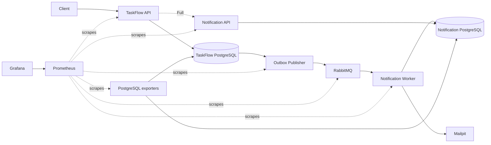

# TaskFlow Performance

Полигон запускает исходные FastAPI-приложения на Docker Desktop в отдельном Compose-проекте `taskflow-performance`. PostgreSQL 17, RabbitMQ, Notification API, Worker, Outbox и Mailpit переиспользуют текущие образы или Dockerfile. Backend сохраняет сессии, проверку Origin и CSRF, SQLAlchemy и Alembic. Схема задач, индексы и форматы событий совпадают с development.



## Запуск из PowerShell

Команды выполняются из корня репозитория. Нужны Docker Desktop в режиме Linux containers, Compose v2 и PowerShell. Локальный Python нужен только для диагностики и экспорта параметров.

```powershell
.\performance\initialize.ps1
$Perf = @('--env-file', 'performance/.env.example', '-f', 'performance/compose.yaml')
$Medium = @('-f', 'performance/profiles/medium.yaml')
$Full = @('-f', 'performance/full.yaml', '--profile', 'full')
docker compose @Perf @Medium config --services
docker compose @Perf @Medium up -d --build --wait
```

Core запускает backend и PostgreSQL. Контейнер миграций завершает работу после `alembic upgrade head`. Для Full используйте overlay и одноимённый Compose profile вместе.

```powershell
docker compose @Perf @Full @Medium config --services
docker compose @Perf @Full @Medium up -d --build --wait
```

Для возврата из Full в Core сначала выполните `docker compose @Perf @Full @Medium down`, затем команду запуска Core. `down` сохраняет именованные тома. Сеть `taskflow-performance-observe` создаётся один раз, проверяется по метке и используется только полигоном и мониторингом. Сохраните имя проекта из Compose, чтобы избежать дублирования DNS-имён на этой сети. Development использует собственные тома, контейнеры и сеть `taskflow-network`.

```powershell
docker compose -f monitoring/compose.yaml up -d --wait
docker compose -f monitoring/compose.yaml down
```

| Интерфейс | Локальный адрес |
|---|---|
| TaskFlow REST API / Swagger | http://127.0.0.1:8100/docs |
| Notification API / Swagger | http://127.0.0.1:8101/docs |
| RabbitMQ Management | http://127.0.0.1:25672 |
| Mailpit | http://127.0.0.1:8026 |
| Prometheus | http://127.0.0.1:19090 |
| Grafana | http://127.0.0.1:3001 |

Все опубликованные порты привязаны к IPv4 loopback. Используйте один hostname для Origin и сессионных cookie. Два PostgreSQL, AMQP, SMTP, exporters и метрики фоновых процессов доступны внутри сети. Порт 9090 зарезервирован Windows на проверенной машине. Он остаётся внутренним портом Prometheus.

## Настройки и профили

Скопируйте `performance/.env.example` в `performance/.env` для своих параметров, затем замените путь в массиве `$Perf`. Локальные значения в примере предназначены для учебного полигона. При смене `PERF_EXPORTER_PASSWORD` передайте то же значение мониторингу. PostgreSQL и RabbitMQ применяют начальные пароли при создании тома. Для существующих томов измените пароль роли в соответствующем сервисе и согласованно обновите клиентские настройки.

| Параметры | Назначение и исходные значения |
|---|---|
| `PERF_DB_PASSWORD`, `PERF_NOTIFICATION_DB_PASSWORD`, `PERF_RABBITMQ_PASSWORD`, `PERF_EXPORTER_PASSWORD`, `PERF_INTERNAL_TOKEN` | Раздельные локальные пароли и токен межсервисного HTTP |
| `PERF_API_PORT`, `PERF_NOTIFICATION_API_PORT`, `PERF_RABBITMQ_PORT`, `PERF_MAILPIT_PORT` | Публикации на 8100, 8101, 25672, 8026 |
| `PERF_METRICS_ENABLED` | true в Performance, false по умолчанию в development (`METRICS_ENABLED`) |
| `BACKEND_WORKERS` | 1. Процессы Gunicorn с Uvicorn worker. Миграции выполняются отдельным контейнером |
| `DB_POOL_SIZE`, `DB_MAX_OVERFLOW`, `DB_POOL_TIMEOUT`, `DB_POOL_RECYCLE`, `DB_POOL_PRE_PING` | 5, 10, 30 с, −1 без периодической ротации, true |
| `PERF_PG_MAX_CONNECTIONS` | 100 на экземпляр; `pg_stat_statements` и `track_io_timing` включены |
| `RABBITMQ_PREFETCH`, `SMTP_DELIVERY_CONCURRENCY` | 1 и 1 на Worker. AMQP callback обрабатывается последовательно; SMTP threads получают разные задачи через leases и `SKIP LOCKED` |
| `OUTBOX_BATCH_SIZE`, `OUTBOX_POLL_INTERVAL` | 1 попытка между обработкой heartbeat и задержка 1 с при пустой выборке. Транзакция и подтверждение остаются на одно событие |
| `HTTP_CONNECT_TIMEOUT`, `HTTP_READ_TIMEOUT` | 2 с на подключение и чтение Notification API из backend. Настройки пользовательского клиента задаются отдельно |

| Компонент | LOW CPU / RAM | MEDIUM CPU / RAM | HIGH CPU / RAM |
|---|---:|---:|---:|
| Backend | 0.5 / 512 MiB | 1 / 1 GiB | 4 / 2 GiB |
| Каждая PostgreSQL | 0.5 / 512 MiB | 1 / 1 GiB | 2 / 2 GiB |
| Notification API | 0.5 / 256 MiB | 1 / 512 MiB | 2 / 1 GiB |
| Каждый Notification Worker | 0.5 / 256 MiB | 1 / 512 MiB | 2 / 1 GiB |
| Outbox Publisher | 0.5 / 256 MiB | 0.5 / 512 MiB | 1 / 512 MiB |
| RabbitMQ | 0.5 / 512 MiB | 1 / 1 GiB | 2 / 2 GiB |

Профиль — Compose overlay `performance/profiles/low.yaml`, `medium.yaml` или `high.yaml`. Передавайте один overlay и повторяйте `up -d --wait`. Лимиты Docker Desktop задают верхний предел для всех контейнеров. Mailpit и одноразовые миграции без отдельных лимитов профиля.

Верхняя граница соединений backend — `BACKEND_WORKERS × (DB_POOL_SIZE + DB_MAX_OVERFLOW)`. В Full отдельно учтите пул publisher, exporter, миграции, диагностические клиенты, зарезервированные слоты и подключения Notification DB. Метрики занятых слотов суммируются только между живыми процессами. При выходе из worker Gunicorn удаляет его файлы с live gauges. Counters и buckets остаются до перезапуска master. После перезапуска master каталог метрик новый, используйте `rate()` и `increase()` для учёта сбросов.

```powershell
$env:BACKEND_WORKERS = '2'
docker compose @Perf @Full @Medium up -d --wait --scale notification-worker=3
Remove-Item Env:BACKEND_WORKERS
```

Каждый Notification Worker экспортирует метрики по своему IP на внутреннем порту 9102, Prometheus обнаруживает IP через Docker DNS. Изменение числа CPU в overlay не меняет количество процессов.

## Наборы данных

| Dataset | Пользователи | Задач на пользователя | Всего задач |
|---|---:|---:|---:|
| smoke | 5 | 20 | 100 |
| small | 20 | 50 | 1 000 |
| medium | 100 | 100 | 10 000 |
| large | 100 | 1 000 | 100 000 |
| xlarge | 1 000 | 1 000 | 1 000 000 |
| single-heavy-user | 1 | 100 000 | 100 000 |

```powershell
docker compose @Perf exec -T backend python /performance/scripts/seed_test_data.py --dataset smoke --dataset-id smoke-db --mode db --analyze
docker compose @Perf @Full exec -T backend python /performance/scripts/seed_test_data.py --dataset smoke --dataset-id smoke-api --mode api --concurrency 2 --format csv
docker compose @Perf exec -T backend python /performance/scripts/seed_test_data.py --dataset large --distribution skewed --dry-run
docker compose @Perf exec -T backend python /performance/scripts/seed_test_data.py --dataset large --allow-large --distribution skewed --batch-size 2000 --status-weights 50 30 20 --seed 42
```

DB mode использует batch inserts с транзакциями и штатный Argon2-хеш TaskFlow. Задачи получают воспроизводимые заголовки, статусы, даты и описания. По `--analyze` обновляется статистика PostgreSQL. DB mode создаёт записи без Outbox и писем. API mode регистрирует пользователей, логинится, получает CSRF и создаёт задачи через настоящий REST API. Таймаут — 10 с на HTTP-операцию, параллелизм ограничен числом пользователей и флагом `--concurrency` (до 16). Даты создания и изменения в API mode назначает сервер. Для защиты от ошибочного выбора цели `--base-url` принимает внутренний `http://127.0.0.1:8000`. Эту команду запускают внутри проверенного backend. Сгенерированные email принадлежат `example.test`. Seed управляет содержимым задач, пароли и префикс адресов создаются отдельно для каждого запуска.

Можно задать `--users` и `--tasks-per-user` поверх preset. Skewed отдаёт примерно 80% задач верхним 10% пользователей, с округлением и сохранением общего числа. От 100 000 задач, от 1 000 пользователей или свыше 10 000 задач в API mode требуется `--allow-large`. `--output /performance/artifacts/example.csv` задаёт путь к новому файлу. Каталог виден на хосте как `performance/artifacts/` и исключён из Git. Опубликуйте отчёт отдельно от файлов credentials. Результат генерации содержит счётчики, длительность, ID и путь к файлу. При частичном сбое удалите зарегистрированный dataset и повторите запуск с новым или освобождённым ID.

## Очистка выбранного набора

Каждая запись каталога фиксирует UUID пользователя в транзакции его создания. По этим UUID выбираются задачи и сессии, Outbox, уведомления и доставки. В Mailpit удаляются письма, чьи адресаты точно принадлежат выбранному набору. Параллельные операции генерации и удаления ограничены advisory lock, а база проверяется по имени, пользователю и записи `performance.identity`. Dry-run показывает план.

```powershell
.\performance\cleanup.ps1 -DatasetId smoke-db
.\performance\cleanup.ps1 -DatasetId smoke-db -Apply

.\performance\cleanup.ps1 -DatasetId smoke-api -Full
# Остановите внешнюю нагрузку и дождитесь пустых очередей.
docker compose @Perf @Full stop outbox-publisher notification-worker
.\performance\cleanup.ps1 -DatasetId smoke-api -Full -Apply
docker compose @Perf @Full @Medium up -d --wait
```

Для Full требуется отсутствие consumers и сообщений во всех очередях, включая retry и DLQ. Это сохраняет данные других datasets в брокере. Разберите DLQ отдельно перед очисткой. Другие клиенты не должны писать в полигон во время удаления. Между двумя PostgreSQL и Mailpit нет общей транзакции. При техническом сбое повторите ту же очистку после восстановления сервисов. Успешные удаления в Notification DB и Mailpit можно безопасно повторить, основной каталог удаляется последним. Файлы с credentials удаляются отдельно с хоста.

**Полный сброс необратимо удаляет данные Performance PostgreSQL, RabbitMQ и Mailpit.** Остановите эксперименты, проверьте имя проекта и выполните `docker compose @Perf @Full down --volumes`, если действительно нужен полный сброс.

При использовании отдельного env-файла передайте `cleanup.ps1 -EnvFile performance/.env`.

## Диагностика окружения

```powershell
python performance/scripts/inspect_environment.py
python performance/scripts/export_environment.py --output performance/artifacts/experiment-01.json
docker stats --no-stream $(docker ps -q --filter "label=com.docker.compose.project=taskflow-performance")
```

Снимок содержит UTC timestamp, commit, признак изменений в рабочем дереве, image ID, CPU/RAM, health, рестарты, OOMKilled, разрешённые параметры приложений, число Worker, состояния очередей, размеры БД и datasets. Название resource profile определяется по лимиту backend; сравнивайте также фактические лимиты остальных сервисов. При нестандартных портах передайте `--prometheus-url` и `--grafana-url`.

## Диагностический SQL

```powershell
Get-Content -Raw performance/sql/top_slow_queries.sql | docker compose @Perf exec -T db psql -X -v ON_ERROR_STOP=1 -U taskflow_perf -d taskflow_performance
$Owner = docker compose @Perf exec -T db psql -XAt -U taskflow_perf -d taskflow_performance -c "SELECT user_id FROM performance.accounts WHERE dataset_id='smoke-db' ORDER BY position LIMIT 1"
Get-Content -Raw performance/sql/explain_tasks.sql | docker compose @Perf exec -T db psql -X -v ON_ERROR_STOP=1 -v "owner_id=$Owner" -v search=release -v page_offset=0 -U taskflow_perf -d taskflow_performance
```

| SQL | Что смотреть |
|---|---|
| `top_slow_queries.sql`, `top_total_execution_time.sql` | `pg_stat_statements`: calls, total/mean/max в мс, строки, shared/temp blocks, нормализованный SQL |
| `active_connections.sql`, `connection_usage.sql`, `long_running_transactions.sql` | Состояние, возраст, waits и запас соединений |
| `database_locks.sql`, `blocking_queries.sql` | Ожидающие блокировки и блокирующие PID |
| `table_statistics.sql`, `index_usage.sql`, `database_size.sql` | Seq/index scans, статистика обслуживания, размеры таблиц и индексов |
| `cache_hit_ratio.sql`, `io_statistics.sql` | Shared buffers, физические операции на уровне PostgreSQL 17 и время I/O |
| `explain_tasks.sql` | Поиск через `lower(title) LIKE`, фильтры статуса, сортировка, offset и счётчики Dashboard из `/tasks` |

`EXPLAIN ANALYZE` выполняет запрос. Для операций записи это может изменить данные. Запросы в примерах читающие. Для исследуемого параметра поиска с `%`, `_` или `/` воспроизведите экранирование SQLAlchemy `icontains(autoescape=True)`. Сопоставляйте actual и estimated rows, ожидания, sort method и shared read/hit. Shared read показывает обращение за пределы shared buffers, которое может обслужить файловый кэш ОС. SQL-вывод оставляйте локальным.

## Последовательность экспериментов

1. Запустите Core MEDIUM, загрузите smoke, сделайте короткую базовую серию и экспортируйте окружение. Повторите на LOW для исследования CPU, throttling, RPS и latency.
2. Исследуйте пул с `DB_POOL_SIZE=1`, `DB_MAX_OVERFLOW=0` и малым `DB_POOL_TIMEOUT`. Сопоставьте acquisition P95, checked-out и таймауты. Меняйте параметры по одному.
3. Повторите поиск, фильтрацию и пагинацию на small, medium и large. Сравните EXPLAIN, pg_stat_statements и cache hit.
4. В Full ограничьте Worker профилем LOW. Исследуйте скорость роста RabbitMQ и время обработки backlog после прекращения нагрузки.
5. Остановите только RabbitMQ командой `docker compose @Perf @Full stop rabbitmq`, затем верните через `start rabbitmq`. Сравните Outbox pending, возраст, retry и скорость восстановления.
6. Проделайте то же с Mailpit. Сопоставьте SMTP pending, retry, failed и event-to-SMTP latency после восстановления.
7. Сравните 1, 2 и 3 экземпляра Worker с одинаковым остальным окружением. Отдельно сравните число backend workers и запас подключений.
8. После коротких тестов переходите к spike, stress, capacity и длительной равномерной нагрузке. Во время soak сопоставляйте память, соединения, очереди и размер диска. Между прогонами храните снимок окружения и возвращайте baseline.

Инструкции по observability и ограничения Windows описаны в [monitoring README](../monitoring/README.md). Результаты проверок и перечень файлов приведены в [отчёте](VERIFICATION.md).
